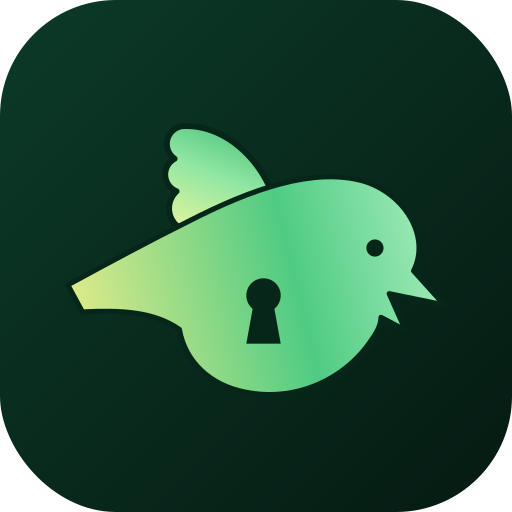

  

<h1 align="center">Sparrow Pass</h1>

  A private, local-first password manager for desktop. 
  One encrypted file. No account. No cloud. No tracking.

  
  
  

---

> **Early alpha.** Sparrow Pass is under active development and has **not** been independently security-audited yet. Please do not rely on it as your only copy of important passwords.

## What is Sparrow Pass?

Sparrow Pass is the first app of the **Sparrow** ecosystem: a family of small, privacy-first tools that keep your data on your own devices. Your passwords live in a single encrypted file that you place wherever you like, on your disk, on a USB drive, or in a folder you already sync yourself.

The app does not use the network at all. There is no account to create and nothing to sign in to.

## What works today

**Vault**
- Passwords, secure notes and bank cards in one vault
- Tags for organizing entries and fast search across titles, usernames, addresses and notes
- Two views: a compact list or tiles, with the entry details shown on the right
- Built-in password generator (length, character sets, option to skip look-alike characters)

**Import**
- Bitwarden (unencrypted `.json` export)
- Chrome, Bitwarden and other `.csv` exports
- Duplicates are skipped automatically

**Look and feel**
- A calm green theme out of the box
- Your own colors: pick a preset or type any HEX value for the accent and background colors, and the change applies instantly
- Your theme is stored inside the encrypted vault and follows the file

**Everyday safety**
- Locks itself after 15 minutes of inactivity
- Copied passwords are removed from the clipboard after 30 seconds
- Passwords and card numbers stay hidden until you reveal them

## How your data is protected

| Part | Choice |
|---|---|
| Key derivation | Argon2id (64 MiB memory, 3 passes) with a random salt |
| Encryption | AES-256-GCM with a fresh random nonce on every save |
| Integrity | The file header is authenticated, so tampering is detected |
| Saving | Written atomically, with a `.bak` copy of the previous version |
| Network | None. The app never connects to the internet |

Your master password is never stored and cannot be recovered. If you forget it, the data cannot be opened. That is the price of real privacy.

Known limitation: while you type the master password, the UI toolkit keeps it in an ordinary string that cannot be wiped from memory. The encryption keys themselves are cleared when the vault locks.

## Roadmap

**Towards the first release (MVP)**
- [x] Encrypted local vault with passwords, notes and cards
- [x] Search, tags, list and tile views
- [x] Password generator
- [x] Import from Bitwarden and CSV
- [x] Custom colors and theme
- [x] Auto-lock and clipboard clearing
- [ ] **Device transfer** by QR code or a 7-digit code, end-to-end encrypted so that even the relay in the middle cannot read your data
- [ ] Change the master password from the interface
- [ ] Export (encrypted backup and CSV)
- [ ] Windows installer and signed builds
- [ ] Independent security review

**After the first release**
- [ ] Android app sharing the same core
- [ ] Authenticator (2FA codes)
- [ ] Browser extension with autofill
- [ ] Entry history and trash
- [ ] Optional sync between devices

## Part of the Sparrow ecosystem

Sparrow Pass is built on shared building blocks that the other Sparrow apps will use as well. Device transfer uses a modern password-authenticated key exchange (CPace) with authenticated encryption, so a short code can be entered by hand without weakening security.

## Build from source

You need JDK 17 or newer. Full instructions, including how to produce a Windows `.exe`, are in [docs/BUILDING.md](docs/BUILDING.md).

## License

No license has been chosen yet. Until then, all rights are reserved.

---

<b>Кратко по-русски</b>

**Sparrow Pass** — приватный менеджер паролей для компьютера, первое приложение экосистемы **Sparrow**. Все данные лежат в одном зашифрованном файле, который вы храните там, где удобно. Аккаунта и облака нет, приложение вообще не выходит в интернет.

**Что уже есть:** пароли, заметки и банковские карты, теги и поиск, вид списком или плитками, генератор паролей, импорт из Bitwarden и CSV, своя цветовая тема (пресеты и любые HEX-цвета), автоблокировка через 15 минут и очистка буфера обмена через 30 секунд.

**Защита:** ключ из мастер-пароля через Argon2id, шифрование AES-256-GCM, защита заголовка файла от подмены. Мастер-пароль нельзя восстановить.

**Дальше:** перенос на другое устройство по QR-коду или коду из 7 цифр, смена мастер-пароля, экспорт, установщик для Windows, независимая проверка безопасности, затем приложение для Android, аутентификатор и расширение для браузера.

Это ранняя альфа-версия без независимого аудита: не храните в ней единственную копию важных паролей.

